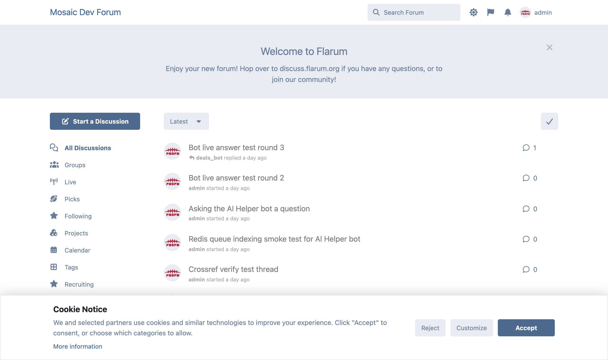
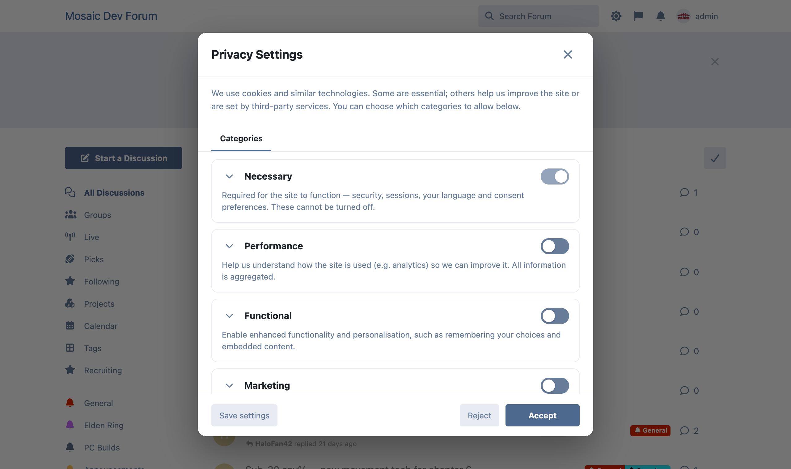
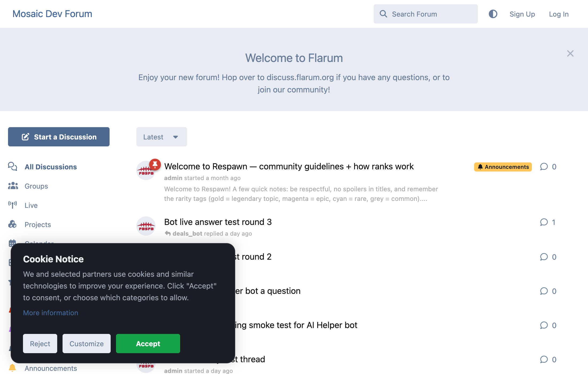

# Advanced Cookie Consent

A GDPR / ePrivacy-style **cookie consent** extension for **Flarum 2**. Free and MIT-licensed.

Shows a clean cookie notice with **Accept / Reject / Customize**, and a granular **Privacy Settings** dialog with consent categories and a per-service transparency view — and, crucially, it can **gate third-party scripts so they only load after consent**.

## Features

- **Cookie notice banner** (bottom bar, corner box, or centered) with Accept, Reject and Customize, plus your Privacy Notice link.
- **Granular Privacy Settings modal** — per-category toggles (Necessary is always on) with expandable detail, plus a **Services** tab listing the third-party services and cookies in each category.
- **Script gating** — two ways to ensure tags only run after consent:
  - Paste scripts per category in the admin panel; they load when that category is accepted.
  - Mark any script on the page as `<script type="text/plain" data-cc-category="marketing">…</script>` and it activates on consent.
- **Clean up on reject / revoke** — optional per-category scripts that run on every page load while a category is declined (e.g. to delete its cookies), plus browser events and a JS API for your own code.
- **Admin-defined categories** (rename, add, remove, mark required) — defaults: Necessary, Performance, Functional, Marketing.
- **Consent versioning** — bump the version to re-prompt everyone when your policy changes.
- **Do Not Track / Global Privacy Control** — optionally auto-reject non-essential categories when the browser sends an opt-out signal.
- **Fully stylable** — layout (bottom bar / corner box / centered), light / dark / auto theme, custom accent colour, box width and corner radius, so it fits any site and screen size.
- **Reopen anytime** — a "Cookie settings" link, plus a JS API so a theme can place its own trigger.
- Fully translatable; consent is stored locally (no personal data leaves the browser).

## Screenshots

| Cookie notice | Privacy settings |
| --- | --- |
|  |  |

Fully **stylable** so it fits any forum — choose the layout (bottom bar / corner box / centered), a light/dark/auto theme, your own accent colour, box width and corner radius:



## JavaScript API

```js
window.cookieConsent.open();                // re-open the settings dialog
window.cookieConsent.accepted('marketing'); // boolean
window.cookieConsent.get();                 // { necessary: true, performance: false, … } or null before a decision
window.cookieConsent.on((detail) => { /* … */ }); // every decision; returns an unsubscribe function
window.cookieConsent.onChange((c) => { /* … */ }); // older form, receives { version, categories, ts }
window.cookieConsent.acceptAll();
window.cookieConsent.rejectAll();
```

### Events

Both are dispatched on `window`, so code can listen without waiting for Flarum to boot.

| Event | When | `event.detail` |
| --- | --- | --- |
| `cookie-consent:ready` | On every page load, once the banner has started | `{ categories }` — the current decision, or `null` if the visitor hasn't chosen yet |
| `cookie-consent:change` | Whenever consent is given, rejected, changed or revoked (including an automatic Do Not Track / GPC rejection) | `{ action, categories, previous, granted, revoked, rejected }` |

- `action` — `'accept'` (Accept all), `'reject'` (Reject all) or `'save'` (custom choice in Privacy Settings).
- `categories` — every category key and whether it is now allowed; `previous` is the same for the last decision, or `null`.
- `granted` — categories switched on by this decision; `revoked` — categories that were on and are now off; `rejected` — every category that is now off.

When anything is revoked the page **reloads right after** `cookie-consent:change`, to stop scripts that are already running. Listeners run first, so it is safe to delete cookies there.

Example: delete Google Analytics cookies when the Performance category is rejected or revoked, now and on every later page load:

```html
<script>
  function clearGaCookies() {
    document.cookie.split(';').forEach(function (c) {
      var name = c.split('=')[0].trim();
      if (name === '_ga' || name.indexOf('_ga_') === 0 || name === '_gid') {
        [location.hostname, '.' + location.hostname.replace(/^www\./, '')].forEach(function (domain) {
          document.cookie = name + '=; Max-Age=0; path=/; domain=' + domain;
        });
        document.cookie = name + '=; Max-Age=0; path=/';
      }
    });
  }
  window.addEventListener('cookie-consent:ready', function (e) {
    if (e.detail.categories && !e.detail.categories.performance) clearGaCookies();
  });
  window.addEventListener('cookie-consent:change', function (e) {
    if (e.detail.rejected.indexOf('performance') !== -1) clearGaCookies();
  });
</script>
```

You can put that in your own theme or head-items extension, or skip the listeners entirely: paste `<script>` + the `clearGaCookies` function + `clearGaCookies();</script>` into the Performance category's **reject scripts** box in the admin panel. Those run on each page load while the category is declined, and straight away when a visitor first rejects it.

## Installation

```sh
composer require ernestdefoe/advanced-cookie-consent
php flarum cache:clear
```

Then open **Admin → Advanced Cookie Consent** to set your text, categories and scripts.

## Support

- **Support forum:** [Advanced Cookie Consent on ernestdefoe.online](https://ernestdefoe.online/d/66)
- **Bug reports:** [GitHub issues](https://github.com/ernestdefoe/advanced-cookie-consent/issues)

## License

[MIT](LICENSE)
